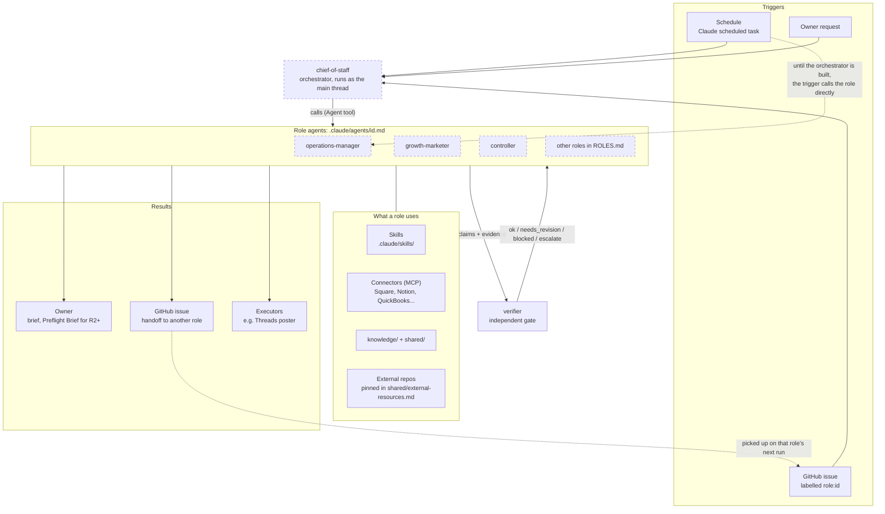
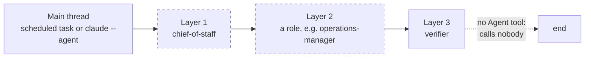
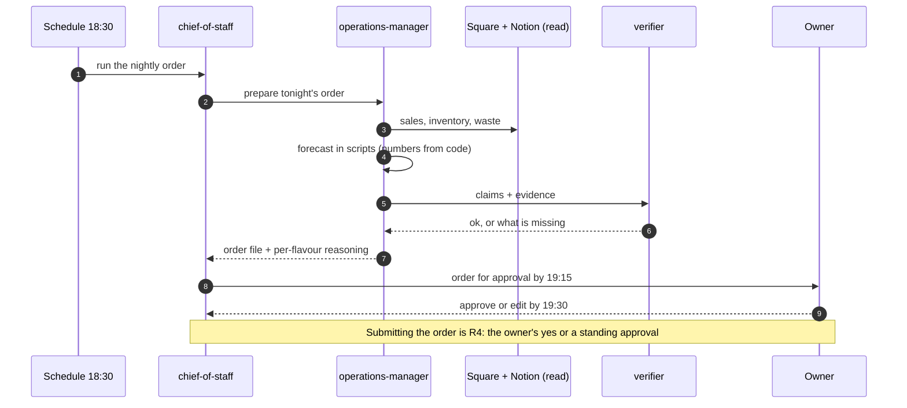
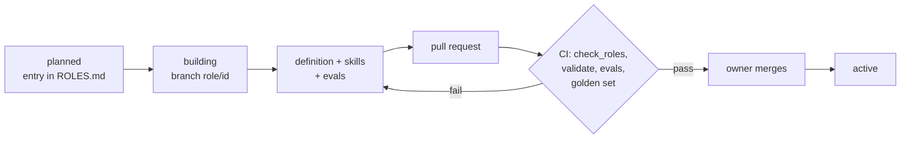

# Architecture

How the agents run, how they call each other, and where every file goes. The diagrams render on GitHub. Planned parts are drawn with dashed lines; `ROLES.md` is the source of truth for what is built.

## 1. How a run flows



Rules the diagram encodes:
- A role calls only the roles in its `can_call` list. Gates (the verifier) never call producers.
- Short sub-tasks are direct calls in the same run. Long or slow work, or work on another machine, is a GitHub issue labelled `role:<id>`.
- Only results come back from a call, not the callee's working context. The verifier skips the project `CLAUDE.md` so it never sees the producer's reasoning.

## 2. Call depth and the orchestrator



- **Where the orchestrator lives:** `.claude/agents/chief-of-staff.md`, the same shape as every other role. Not in the root `CLAUDE.md`, which loads into every agent.
- **How it runs:** on a server, `claude --agent chief-of-staff` makes it the main thread, where its `tools: Agent(role-a, role-b)` allowlist is enforced by Claude Code. From a cloud scheduled task, the task's prompt hands off to it, which uses one more layer.
- **Depth budget:** Claude Code allows subagents three layers below the main thread by default, so orchestrator, role and verifier fit exactly. Roles should not chain further.
- **What it does:** routing, the daily brief, budget watch, and batching what needs the owner. No domain work of its own.

## 3. Example: tonight's order (once built)



## 4. Where files go

```
agent-os/
├── CLAUDE.md                  rules for every agent (short: loads on every run)
├── ROLES.md                   every planned role, status, build order
├── ARCHITECTURE.md            this file
├── BUILD-PROTOCOL.md          how to build a role + the definition template
├── .claude/
│   ├── agents/<id>.md         one definition per built role: instructions, model,
│   │                          tools, skills, connectors, can_call, status
│   └── skills/<skill>/        SKILL.md, scripts/, fixtures/ (synthetic), evals/cases.json
├── agents/<id>/               role-only material: rubrics, examples, references, golden cases
├── shared/                    owner context, autonomy matrix, Preflight Brief,
│                              knowledge rules, external resources
├── contracts/                 JSON schemas, validate.py, check_roles.py
├── knowledge/<namespace>/     sourced, dated records (K-<namespace>-NNNN.json)
├── .github/workflows/         evals.yml (CI), daily-post.yml (poster)
└── bloor-assets/, scripts/    the live Threads poster (moving to its own repo)
```

| You are adding... | It goes in |
|---|---|
| A new role | Entry in `ROLES.md`, definition in `.claude/agents/<id>.md` |
| A skill for a role | `.claude/skills/<skill>/` (Claude Code only finds skills there), listed in the role's `skills:` |
| A script that computes a number | The skill's `scripts/` folder |
| Rubrics, examples, golden cases | `agents/<id>/` |
| A standard that changes over time (style, cadence) | `shared/` or `agents/<id>/references/`, pointed to from the definition |
| A fact the agents should remember | `knowledge/<namespace>/`, valid against `contracts/knowledge-record.schema.json` |
| A connector a role needs | The role's `mcpServers:` |
| A third-party skill or repo | Row in `shared/external-resources.md`, pinned to a commit |
| A secret or real business data | Never here: secrets in GitHub or a password manager, data in the private store |

## 5. A role's lifecycle



## 6. Built as mechanisms, not agents

| Was a planned agent | Now |
|---|---|
| Guardian | Each role's `tools`, `mcpServers`, scoped credentials and hooks; the autonomy matrix decides what needs the owner |
| Librarian | `knowledge/` plus the rules in `shared/knowledge.md` |
| Data Steward | Validation scripts inside each pipeline |
